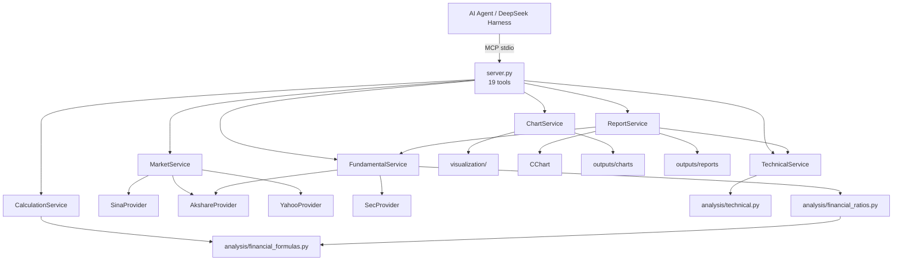
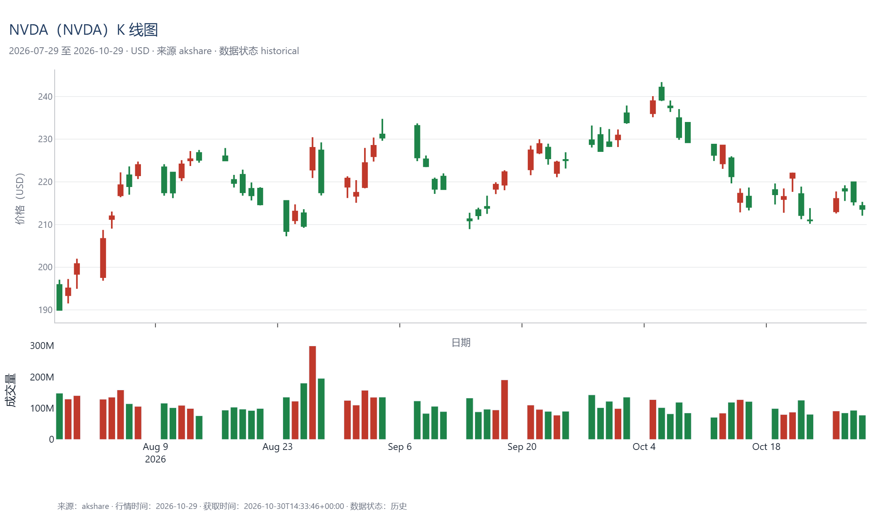
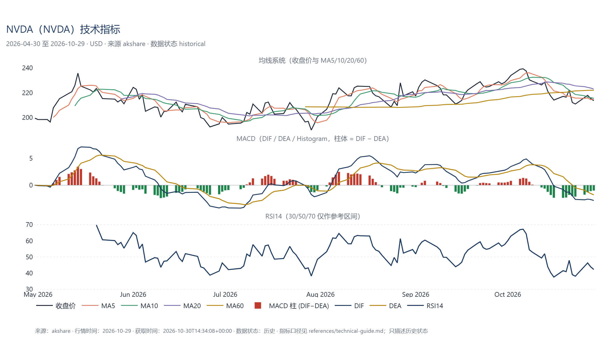
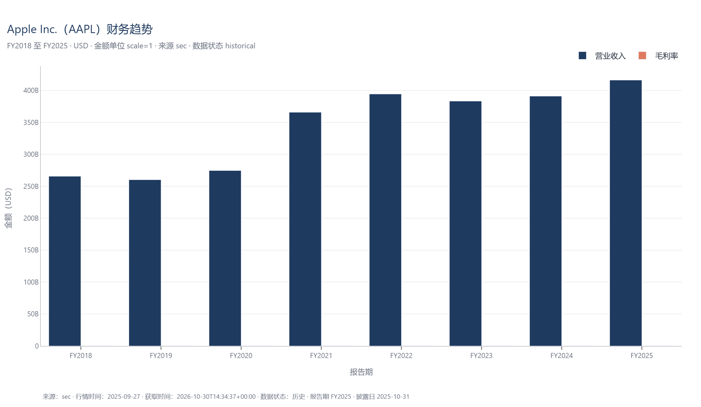
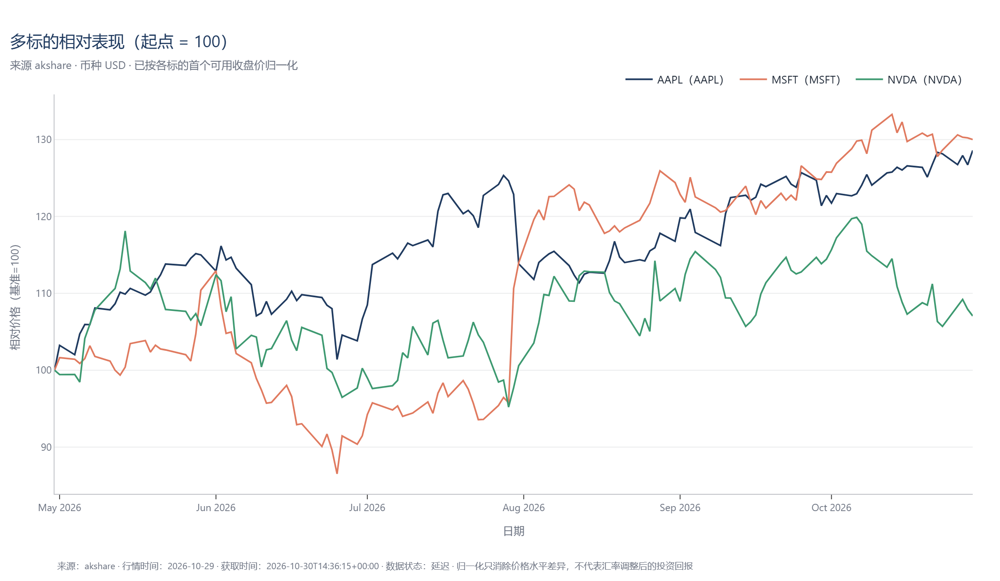

# Financial Market Intelligence

[](https://github.com/ERos1on-Befound/FMI-plugin/actions/workflows/tests.yml)
[](https://github.com/ERos1on-Befound/FMI-plugin)
[](LICENSE)
[](https://modelcontextprotocol.io)

> A Lightweight Financial Market Data Retrieval & Research Skill

面向 AI Agent 的轻量金融数据检索与研究中心：以 **MCP Server** 形式提供行情、历史行情、公开财报、金融公式、基本面分析、技术面分析，并能把结果整理成**可追溯的图表与分析报告**。

不做专业终端覆盖，不提供投资建议、交易指令或价格预测。目标是把公开免费数据变成 Agent 能直接用、能自查、能复现的结构化结果。

---

## 1. 定位

| 是 | 不是 |
| --- | --- |
| 公开免费数据的**检索 + 计算 + 整理**工具 | 行情终端、交易系统、投研平台 |
| 明确标注来源、时间、币种、数据状态 | 保证实时、保证完整、保证准确 |
| 公式与指标由代码计算，可复现 | 由语言模型"心算"或估算 |
| 数据不足时如实返回 `insufficient_data` / `unavailable` | 用 0 或旧数据填充缺失 |
| 只描述历史状态与数据事实 | 提供买卖建议、目标价、评级、收益承诺 |

## 2. 核心功能

1. **实时/延迟行情**：A 股、港股、美股、指数、期货参考价，统一 `Quote` 模型。
2. **历史行情**：日/周/月 OHLCV，按周期窗口自动裁剪与聚合。
3. **市场概览**：A 股、港股、美股、大宗商品四组固定横截面。
4. **公开财务数据**：美股 SEC EDGAR（XBRL）、A 股与港股定期报告镜像，统一为三大报表 + 报告期/披露日/币种/单位。
5. **金融公式引擎**：27 个内置公式 + 安全自定义表达式（AST 白名单，**不使用 `eval`**）。
6. **基本面分析**：盈利 / 偿债 / 运营 / 成长 / 现金流五维度 + 多期趋势 + 估值（数据允许时）。
7. **技术面分析**：SMA / EMA / RSI / MACD / Bollinger / ATR，附历史状态描述。
8. **图表生成**：Plotly 输出 HTML（+ PNG / JSON），支持 K 线、成交量、指标面板、财务趋势、多标的对比。
9. **分析报告**：基本面 / 技术面 / 综合 / 公司对比，输出 Markdown 与独立 HTML，可自动插图。
10. **MCP 工具接口 + Skill 指引**：19 个工具，配 `SKILL.md` 与 6 篇参考文档指导 Agent 选工具、写结果。

## 3. 架构



分层职责：`providers` 只取数、`services` 编排（回退/缓存/组装）、`analysis` 纯计算、`models` 统一模型、`visualization` 只画图、`server` 只注册工具与兜底。

## 4. 数据源

| 数据源 | 市场 | 支持功能 | 当前状态 | 已知限制 |
| --- | --- | --- | --- | --- |
| 新浪财经 | A 股 / 港股 / 美股 / 指数 / 期货 | 报价 | ✅ 可用 | 延迟快照，无分时、无逐笔、无盘口 |
| AKShare | A 股 / 港股 / 美股 / 指数 / 期货 | 历史行情、A 股与港股财报 | ✅ 可用 | 依赖上游网页接口，可能变更；A 股季报为年初至今累计口径 |
| SEC EDGAR | 美股 | 财报（10-K / 10-Q XBRL） | ✅ 可用 | 需要合规 User-Agent；部分科目（如利息费用）并非每期披露 |
| yfinance | 全球 | 报价 / 历史行情（回退） | ⚠️ 本环境被 Yahoo 限流 | 仅作可移植回退，不保证成功 |
| 东方财富（Eastmoney） | A 股 | 报价 / 历史行情（可选 Provider） | ❌ 停用 / 不可用 | push2 接口在判定请求过多时**直接断开 TCP**（无 HTTP 状态码），本项目不再尝试修复，默认关闭（详见 [docs/eastmoney-diagnosis.md](docs/eastmoney-diagnosis.md)） |

财务数据说明：A 股与港股的定期报告来自 AKShare 对交易所/披露易披露文件的镜像，因此没有单独的 `cninfo.py` / `hkex.py` ——把来源命名成 CNINFO 或 HKEX 会误导用户。详细状态见 [docs/data-sources.md](docs/data-sources.md)。

> 所有行情都是**延迟**数据（`data_status="delayed"`），免费源无法证明实时性。

## 5. 安装

```bash
git clone https://github.com/ERos1on-Befound/FMI-plugin.git
cd FMI-plugin
uv sync
```

要求 Python ≥ 3.12 与 [uv](https://docs.astral.sh/uv/)。PNG 导出（可选）需要本机有 Chromium 或 Chrome；没有时 HTML 仍然正常生成。

验证安装：

```bash
uv run python -m pytest -q        # 368 个离线用例
uv run python scripts/smoke_test.py   # 启动 MCP、列工具、离线调用
```

## 6. 启动 MCP Server

```bash
# 方式一：项目虚拟环境（推荐）
uv run python -m financial_intelligence.server

# 方式二：安装后的入口
uv run financial-intelligence-mcp

# 方式三：HTTP 传输（调试用）
uv run python -m financial_intelligence.server --transport streamable-http --port 8765
```

默认 stdio 传输，日志写 stderr（stdout 专用于 MCP 协议）。

## 7. DeepSeek Harness 接入

在 Harness 的 MCP 配置中加入（**把路径替换成你自己的虚拟环境解释器**）：

```json
{
  "mcpServers": {
    "financial-market-intelligence": {
      "command": "<PROJECT_DIR>/.venv/Scripts/python.exe",
      "args": ["-m", "financial_intelligence.server"],
      "cwd": "<PROJECT_DIR>",
      "env": {
        "FMI_SEC_USER_AGENT": "your-name/0.3 (research; contact: you@example.com)"
      }
    }
  }
}
```

说明：

- Linux / macOS 用 `<PROJECT_DIR>/.venv/bin/python`。
- `FMI_SEC_USER_AGENT` 按 SEC 要求填写真实联系方式；不填也能跑，但可能被 SEC 限制。
- 本项目**不自动读取 `.env`**，所有配置通过进程环境变量传入（见 `.env.example`）。

## 8. MCP 工具

### 8.1 市场行情

| 工具 | 说明 |
| --- | --- |
| `get_server_status` | 版本、启用的数据源、模块状态 |
| `get_supported_markets` | 支持的市场、资产类型、周期、间隔、代码写法 |
| `get_stock_quote` | 单只股票 / ETF / 指数报价 |
| `get_asset_quote` | 通用资产报价（指数、期货、中文别名） |
| `get_market_overview` | 四组横截面概览 |

### 8.2 历史行情

| 工具 | 说明 |
| --- | --- |
| `get_historical_data` | OHLCV，`period` / `interval`，自动聚合与截断 |

### 8.3 财务数据

| 工具 | 说明 |
| --- | --- |
| `get_company_financials` | 三大报表 + 报告期 / 披露日 / 币种 / 单位 / 来源 / 缺失字段 |

### 8.4 金融计算

| 工具 | 说明 |
| --- | --- |
| `calculate_financial_metrics` | 按指标名算 21 个财务指标，可多期 |
| `calculate_financial_formula` | 27 个内置公式或安全自定义表达式 |
| `get_supported_indicators` | 公式 / 指标 / 技术指标清单与可用性 |

### 8.5 基本面分析

| 工具 | 说明 |
| --- | --- |
| `analyze_fundamentals` | 五维度 + 多期表 + 结构化结论 + 限制说明 |
| `compare_companies` | 多公司同指标对比（含可比性检查，不排名） |

### 8.6 技术面分析

| 工具 | 说明 |
| --- | --- |
| `get_technical_indicators` | 指标数值与序列 |
| `analyze_technicals` | 指标 + 历史状态描述（不预测） |

### 8.7 图表

| 工具 | 说明 |
| --- | --- |
| `generate_financial_chart` | 六类单标的图，落盘 HTML / PNG / JSON |
| `generate_comparison_chart` | 多标的对比（`base_100` 归一化或比率/金额指标） |
| `get_available_chart_types` | 图表类型与当前可用性 |

### 8.8 报告

| 工具 | 说明 |
| --- | --- |
| `generate_analysis_report` | 基本面 / 技术面 / 综合 / 对比报告，Markdown 或 HTML |
| `get_report_templates` | 四种模板及所需数据 |

## 9. 使用示例

**查行情**

```
AAPL 现在多少钱？
→ get_stock_quote("AAPL")
→ 348.91 USD，+1.48%，延迟行情（行情时间 09:39，来源 sina）
```

**看大盘**

```
今天 A 股和美股什么情况？
→ get_market_overview()
```

**算 ROE**

```
苹果最近三年的 ROE 是多少？
→ calculate_financial_metrics("AAPL", metrics="roe", periods=3)
→ FY2025 171.42%，FY2024 157.41%，FY2023 156.08%（口径：净利润 / 平均股东权益）
```

**基本面报告**

```
帮我分析一下苹果的基本面
→ analyze_fundamentals("AAPL", analysis_scope="full", periods=3)
```

**技术面**

```
英伟达近半年的技术面怎么样？
→ analyze_technicals("NVDA", period="6mo", interval="1d")
```

**K 线图**

```
画一张茅台近一年的日 K 线
→ generate_financial_chart("600519.SS", chart_type="candlestick", period="1y", interval="1d")
→ outputs/charts/stock/600519.SS_candlestick_<时间戳>.html
```

**相对走势**

```
苹果和微软近半年的相对表现
→ generate_comparison_chart("AAPL,MSFT", metric="price", period="6mo", normalization="base_100")
```

**生成报告**

```
帮我生成一份英伟达的技术面报告
→ generate_analysis_report("NVDA", report_type="technical", period="6mo", output_format="html")
→ outputs/reports/NVDA_technical_<时间戳>.md / .html
```

更多真实数据示例见 [examples/](examples/)：市场概览、单只行情、基本面分析、技术面分析、金融计算、[图表](examples/chart_gallery.md)、[报告](examples/report_generation.md)。

## 10. 图表与报告

- 输出目录：`outputs/charts/{stock,technical,fundamental}/`、`outputs/reports/`。
- 文件名含代码、类型与时间戳，重名自动加序号，**不覆盖已有文件**。
- HTML 内联 plotly.js，可离线打开；PNG 通过 kaleido 导出（失败不影响 HTML）；JSON 为 Plotly 图表快照。
- 每张图都记录元数据：`symbol`、`asset_name`、`chart_type`、`period`、`interval`、`currency`、`source`、`retrieved_at`、`data_timestamp`、`generated_at`（财务图另含 `fiscal_period`、`reporting_currency`、`reporting_unit`）。
- **图表生成时间不是行情时间**；报告中的数据期间与披露日单独标注。
- 数据不足时不生成空白图：返回 `unavailable` 并说明原因。

### 真实输出示例

以下 PNG 由 `scripts/make_phase3_examples.py` 用真实数据生成（2026-10-30），原图同时提供可交互 HTML，详见 [examples/chart_gallery.md](examples/chart_gallery.md)。

| NVDA K 线 + 成交量 | NVDA 技术指标面板 |
| --- | --- |
|  |  |

| AAPL 财务趋势（FY2018–FY2025） | 多标的相对表现（base_100） |
| --- | --- |
|  |  |

## 11. 测试

```bash
uv run python -m pytest -q          # 全部 368 个用例，离线
uv run python -m pytest --co -q     # 查看分文件用例数
```

| 测试文件 | 用例数 | 覆盖 |
| --- | --- | --- |
| `test_calculations.py` | 68 | 27 个公式、边界、表达式沙箱 |
| `test_providers.py` | 63 | 代码映射、报文解析、超时、配置 |
| `test_eastmoney.py` | 35 | 东财解码、熔断、冷却持久化 |
| `test_fundamentals.py` | 35 | 科目映射、报告期、服务回退、缓存 |
| `test_financial_ratios.py` | 32 | 21 指标的数值与不可算分支 |
| `test_technical.py` | 28 | SMA/EMA/RSI/MACD/BOLL/ATR 数值校验 |
| `test_visualization.py` | 26 | 六类图 + 对比图，文件真实落盘 |
| `test_mcp_tools.py` | 21 | 19 个工具的发现、参数、结构、路径 |
| `test_services.py` | 21 | 编排、回退、缓存、概览隔离 |
| `test_reports.py` | 14 | 四类报告的结构、来源、缺失、免责 |
| `test_tools.py` | 13 | 工具注册与 stdio 握手 |
| `test_schemas.py` | 12 | 模型字段、枚举、校验 |

真实数据检查脚本（会联网，不在 CI 运行）：`scripts/check_real_data.py`、`scripts/check_financials.py`、`scripts/check_phase3_mcp.py`。

## 12. 项目限制

1. 免费源**延迟**，不保证实时；盘中价可能滞后数分钟。
2. 覆盖不全是真实的：A 股/港股财报缺 `filing_date`（镜像接口不给可信逐期公告日）、缺股本与部分科目；港股与 A 股不支持 TTM 拼接。
3. 东方财富 Provider 因 IP 级限流**默认关闭**，不影响其他数据源。
4. yfinance 在本环境被 Yahoo 限流，仅作可移植回退。
5. 数据源可能随时变更或限流；本项目不做代理池、IP 轮换等绕过手段。
6. 财务科目口径因准则（US GAAP / CAS / HKFRS）不同，跨市场比较需先确认可比性。
7. 类目映射保守：无法确认含义的科目不会被强行映射。
8. 估值指标只在"有可靠股价 + 同币种 + 有股本"时生成；港股等跨币种情形返回 `not_applicable`。
9. 图表与报告依赖数据可用性；数据不足会返回 `unavailable` 而不是生成空文件。
10. 图表/报告是本机文件，路径不保证可被其他机器访问；不提供 PDF（避免引入复杂依赖）。

## 13. 目录结构

```
financial-market-intelligence/
├── README.md  CONTRIBUTING.md  CHANGELOG.md  LICENSE  pyproject.toml  uv.lock
├── .env.example  .gitignore  .python-version
├── .github/workflows/tests.yml
├── docs/                 architecture / data-sources / data-policy / chart-guide
│                         fundamental-guide / technical-guide / formula-reference / troubleshooting
├── skills/financial-market-intelligence/
│   ├── SKILL.md
│   └── references/       data-policy / fundamental-guide / technical-guide
│                         formula-reference / chart-guide / output-format
├── src/financial_intelligence/
│   ├── server.py  config.py  schemas.py
│   ├── providers/        base, sina, akshare, yahoo, sec, eastmoney
│   ├── services/         market, fundamental, technical, calculation, chart, report
│   ├── analysis/         financial_formulas, financial_ratios, fundamental, technical
│   ├── models/           financial_statements, analysis_result, chart_result
│   ├── visualization/    theme, figures, markdown
│   └── utils/            symbol_mapper, validators, bars, cache, timestamps
├── tests/                12 个测试文件 + fixtures/
├── examples/             6 篇真实数据示例
├── scripts/              smoke_test / check_* / make_* / probe_*
└── outputs/              charts/  reports/   （本地生成，不入库）
```

> `outputs/`、`.env`、`.venv/`、各类缓存不会进入版本库（见 `.gitignore`）。

## 14. 许可

项目代码采用 [MIT License](LICENSE)。

需要区分三件事：

- **项目代码**：MIT。
- **第三方数据源的使用条款**：新浪财经、AKShare 上游站点、SEC EDGAR 等各有自己的服务条款与频率限制，使用前请自行确认。
- **数据再分发**：本项目不附带、不再分发任何行情或财报数据；所有数据由使用者运行时自行获取，再分发需遵守对应数据源条款。

## 15. 免责声明

本项目仅用于一般性的数据查询、学习与研究。所有内容**不构成投资建议、交易建议、证券买卖建议、资产管理建议、法律或税务建议**。数据来自公开免费接口，可能存在延迟、缺失或错误，本项目不保证完整性、准确性、及时性。使用者应自行核实并承担使用风险。

---

参考文档：[架构](docs/architecture.md) · [数据源](docs/data-sources.md) · [数据策略](docs/data-policy.md) · [公式清单](docs/formula-reference.md) · [基本面口径](docs/fundamental-guide.md) · [技术指标口径](docs/technical-guide.md) · [图表指南](docs/chart-guide.md) · [故障排查](docs/troubleshooting.md)
