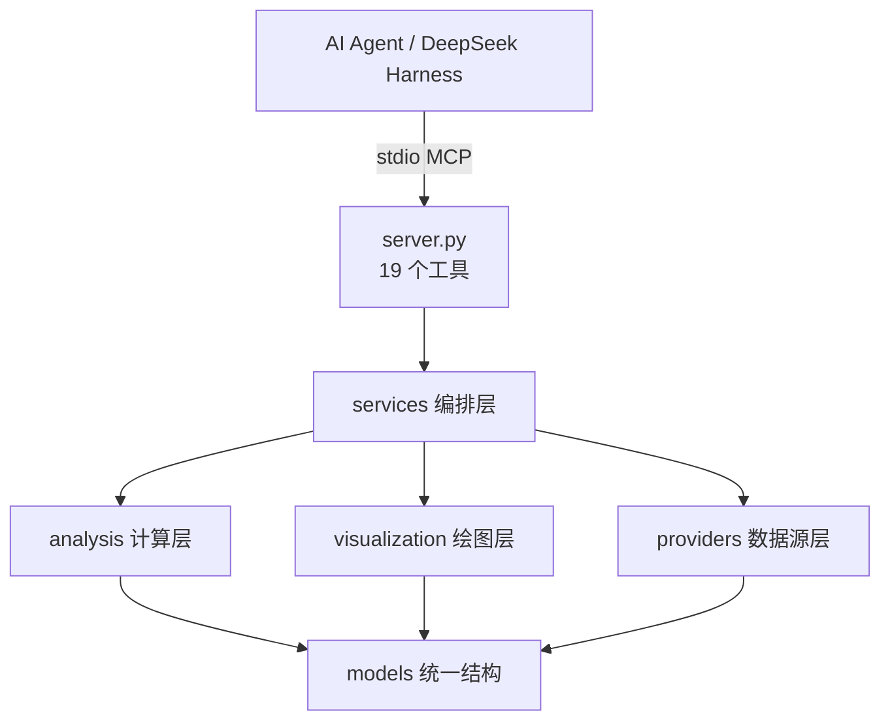

# 架构说明

`financial-market-intelligence` 是一个以 MCP Server 形式提供给 AI Agent 的金融市场数据检索与研究工具。它不做专业终端，也不提供投资建议；它负责**取真实公开数据 → 用 Python 做可复现的计算 → 把结果整理成图表和报告**。

## 分层

| 层 | 目录 | 职责 |
| --- | --- | --- |
| 入口 | `src/financial_intelligence/server.py` | 暴露 MCP 工具、参数校验、把异常转成结构化 `unavailable` |
| 编排 | `services/` | `MarketService`（行情/历史/概览）、`FundamentalService`（财报与指标）、`TechnicalService`（技术指标）、`CalculationService`（公式与能力目录）、`ChartService`（图表）、`ReportService`（报告） |
| 数据源 | `providers/` | `sina`（报价）、`akshare`（历史与 A股/港股财报）、`sec`（美股 XBRL 财报）、`yahoo`（可移植回退）、`eastmoney`（默认停用） |
| 计算 | `analysis/` | `financial_formulas`（27 个注册公式 + 安全表达式）、`financial_ratios`（21 个指标）、`fundamental`（规则式结论）、`technical`（SMA/EMA/RSI/MACD/BOLL/ATR） |
| 绘图 | `visualization/` | `theme`（配色与页脚）、`figures`（10 类 Plotly 图）、`markdown`（Markdown→独立 HTML） |
| 结构 | `models/` | 财务报表（含科目映射）、分析结果、图表/报告结果 |
| 工具库 | `utils/` | 代码映射、校验、日期、缓存 |

## 数据流

1. 工具收到用户参数 → `utils.symbol_mapper.map_symbol` 统一成 `SymbolSpec`（市场、资产类型、币种、各源代码）。
2. Service 按 provider 优先级取真实数据，失败原因合并进 `error`，绝不补 0。
3. `analysis` 只做纯计算：输入是已取到的数值，输出是带 `formula` / `inputs` / `calculation_status` / `explanation` 的结构化结果。
4. `visualization` 只画传入的数据；技术指标一律来自 `analysis.technical`，不在绘图代码里重算。
5. `ChartService` / `ReportService` 把文件写到 `outputs/`，返回**真实存在**的路径与元数据（来源、行情时间、获取时间、数据状态）。

## 时间与状态的区分

- `period_end` / `fiscal_period`：财务**报告期**。
- `filing_date`：**披露日**（SEC 来自 XBRL 的 filed；A股/港股镜像不可靠时留空并在 notes 说明）。
- `retrieved_at`：本次**获取时间**；`data_timestamp`：**行情/数据本身的时间**。
- `generated_at`：图表/报告的生成时间，**不等于**行情时间。
- `data_status`：`realtime` / `delayed` / `historical` / `stale` / `unavailable` / `unknown`。本项目不会把任何延迟行情标成实时。

## 不做什么

不做自动交易、回测、股价预测、目标价、个性化投资建议，不引入数据库/Redis/付费接口。
