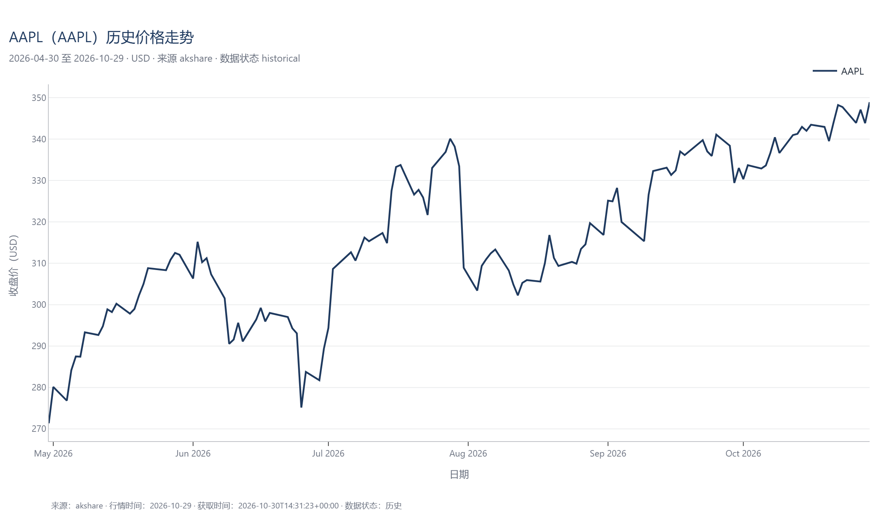

# 图表示例（真实数据）

生成时间：2026-10-30 22:31 北京时间（数据来自真实接口，非模拟）

以下图表全部由 `ChartService` 用真实行情/财报生成，指标来自 `analysis.technical` 与 `analysis.financial_ratios`，绘图代码不另算公式。仓库内的 PNG 是从本机 `outputs/` 复制过来的静态示例；重新生成请运行 `uv run python scripts/make_phase3_examples.py`，会同时产出可交互的 HTML 与 Plotly JSON。

| 图表 | 标的 | 类型 | 数据区间 | 数据点 | 来源 | 状态 |
| --- | --- | --- | --- | --- | --- | --- |
| AAPL line | `AAPL` | line | 2026-04-30 至 2026-10-29 | 127 | akshare | ok |
| NVDA candlestick | `NVDA` | candlestick | 2026-07-29 至 2026-10-29 | 66 | akshare | ok |
| NVDA technical | `NVDA` | technical | 2026-04-30 至 2026-10-29 | 127 | akshare | ok |
| Apple Inc. fundamental | `AAPL` | fundamental | FY2018 至 FY2025 | 8 | sec | ok |
| AAPL vs MSFT vs NVDA comparison | 多标的 | comparison | 2026-04-30 至 2026-10-29 | 127 | akshare | ok |

## AAPL 历史价格（line）

## NVDA K 线 + 成交量

## NVDA 技术指标面板（MA / MACD / RSI）

## AAPL 财务趋势（营业收入、净利润、毛利率）

## 多标的相对表现（base_100）

## 说明

- 归一化对比（`base_100`）把各标的起点都设为 100，只反映相对涨跌，**不代表汇率调整后的投资回报**。
- 不同币种的金额不能放在同一纵轴；比率指标与归一化走势可以。
- 涨 = 红 `#c0392b`，跌 = 绿 `#1e8449`（A 股习惯），全项目统一。
- 图表生成时间不是行情时间：`generated_at` 是出图时刻，`data_timestamp` 是最后一根 K 线或最新报告期。
- 示例 PNG 的行情时间截至 2026-10-29；重新生成会得到当时的最新数据。
